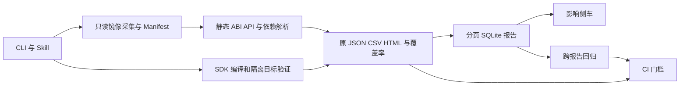

# 最终架构

原入口 `tizen_compat.py` 收集元数据与证据，按 GCC baseline 消费者迁移到 LLVM candidate 的方向运行。静态 Finding 和编译／运行观测各自记录。原 schema 1.2、Finding ID 规则、证据路径与 v1.3 交互报告继续可用。

全量原记录留在各次分析的输出中。影响侧车引用原 Finding 和包角色。历史索引保存两侧原 ID、上下文和匹配依据。CLI 和 loopback 页面通过限定路由、分页和已有 Evidence 解析查看结果。

ARM ELF 可记录 PCS、ISA 属性、TLS、relocations 和 unwind 的静态事实。CPU 属性相同只说明记录一致。C++ 库族和依赖变化只提出验证范围。SDK 使用编译、链接、部署、执行、行为和自身参考的独立阶段。覆盖率与兼容性是两条独立的发布依据。 [Arm ELF ABI](https://github.com/ARM-software/abi-aa/blob/main/aaelf32/aaelf32.rst) · [Arm EHABI](https://github.com/ARM-software/abi-aa/blob/main/ehabi32/ehabi32.rst)
