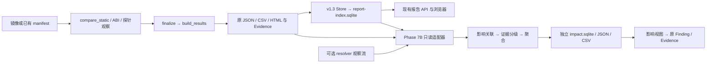

# Phase 7B 兼容性影响分析详细设计 v1.0

评审基线为私有仓库 `main` 的 `f72a246fbce64b6e9ee2341464cbc067b5981c37`，本地 HEAD 与远端一致。该提交包含 Phase 7A，采集策略为 `1.3.1-phase7a`，manifest 和原结果 schema 为 1.2。历史提交 `924ef9f` 为 Phase 7A 修复起点。本文为待 PM 评审的设计。

## 目标与范围

在 GCC baseline → LLVM candidate 方向回答哪些已有调用者依赖发生变化的接口、哪个启动上下文出现了契约缺口、下一项验证需要什么。首个产品配置为 ARMv7/armv7l，沿用 ELF class、字节序、Machine 与 ARM EABI/float ABI 门控。aarch64/x86_64 共享标识协议，按架构独立验收。交换输入产生独立方向和上下文。GCC/LLVM 标签沿用输入来源记录。

新增层保持 Finding、原兼容性状态、覆盖率和 CI 门禁。确认作用域限于已记录的静态 loader 模型与明确的接口元数据。完整运行时装载、自动根因归因、C++ 对象语义、RPM 求解及全产品兼容性认证属于后续工作。

## 架构

`compare_static` 检查 candidate 自身，以及 baseline 消费者在 candidate 上的表现。两者都查 candidate 依赖，后者根程序的权限来自 baseline。当前缺少 baseline 消费者在 baseline 上的对应解析对照。闭包、已加载别名和搜索路径属于 `dependency_checks` 临时状态，结果保留每次检查的直接消费者、根、Provider 路径及部分解析细节。现有 `provider_consumers` 和 v1.3 `groups` 可导航这些观察。`raw_elf` 保存压缩对象，`elf.metadata` 排除 imports、exports 和 cxx，`symbols` 只索引导出。具体来源见 [源码追溯](07_SOURCE_TRACEABILITY.md)。

## 输入档位

| 档位 | 最小输入 | 可得结果 |
|---|---|---|
| `RECORDED` | 已对账的 v1.3 索引及来源身份，或原报告双 manifest、results 和 CSV | 原有状态、声明依赖、已记录的端点和归属。缺基线因果或上下文时，最多 `POSSIBLE_IMPACT` |
| `REPLAYED` | 可验证的 Phase 7A manifest、原始 Finding、匹配的解析器与 loader 配置 | 同一 resolver 生成有界的 baseline 对照及 candidate trace。对比双方前提完整时，确认特定静态契约影响 |
| `TRACE_RECORDED` | 和原报告 manifest、策略、上下文绑定的版本化 trace | 与重放采用同一门控。版本、摘要或上下文不匹配时，明确拒绝选定档位，操作者可另选 `RECORDED` |

仅有已验证增强 SQLite 也可构建 `RECORDED`。Evidence 或原 manifest 不可用时，显式记录缺失状态。SQLite 摘要列、导航组及单独的 `scope_proven` 不授予额外确认。缺少可信输入时终止构建。CSV 缺结构化上下文，单独输入暂不支持。manifest 重放不访问镜像，不回写原 Finding。

## 模块与接口

| 模块提议 | 责任 |
|---|---|
| `impact_source` | 读只读 SQLite 或复用 `ReportStream`。保留原 ID、status、重复次数和来源标识。解压单条记录并写窄行 |
| `impact_trace` | 消费 `dependency_checks` 可选观察器，复用 7A 门控。校验 root、方向、解析策略、输入摘要和原结果 |
| `impact_rules` | 对约束、已选端点和源 Finding 作索引连接，给出关联强度、影响、验证建议及覆盖处置 |
| `impact_store` | 版本化 SQLite、窄索引、冲突检查、对账、事务和发布，生成概览 JSON 和流式 CSV |
| 独立 CLI 与报告扩展 | 暂定 `impact_report.py build --input REPORT --output NEW_DIRECTORY [--mode recorded|replayed|trace]`。影响视图只读挂载 `/api/impact/*`，链接旧 Finding 详情 |

读取器按原序号发送 `SourceFinding`、`ElfObservation` 和 `OwnershipObservation`。处理顺序为来源验证 → 建窄索引 → 观察正规化 → root 上下文内连接 → 分组与归属投影 → 对账 → 发布。未匹配项保留一条带原因的覆盖处置，消费者缺失时保留空值。源结构损坏、引用悬空、数据冲突和资源超限留失败摘要，原报告继续可访问。事务和断点见 [数据模型](02_DATA_MODEL.md)。

## 关联算法

1. 用完整虚拟路径、镜像、scope 与已验证别名识别 ELF。符号约束使用原装饰名、版本、默认版本、类型及要求的版本文件。建立按上下文、已选端点和约束查找的磁盘索引。
2. 从原 Finding 建立底层变化候选。按基线已选 Provider 与完全匹配的需求提取 Consumer，再匹配 candidate 解析结果。仅同名 import 或 DT_NEEDED 不足以绑定指定符号。
3. `RECORDED` 可用同 root 的逐边观察做有界推导。确认所需关系由可信基线对照和 candidate 证据共同支持。多跳传播只作潜在影响或覆盖缺口。已有 root 检查保持原来语义。
4. 按规范根因候选键去重，再单独保存每条路径适用的上下文与消费者。区分唯一 Finding、重复观察数、成员引用、组、消费者、根及包。分批与稳定排序保证可恢复和结果可对账。

## 决策及替代方案

| 选择 | 理由 | 替代方案的代价 |
|---|---|---|
| SQLite 侧车和小 JSON | 历史 v1.3 可按原方式访问，回滚只需停用侧车 | 修改原库需迁移所有历史报告，整报告 JSON 投影增加读写 |
| 提取现有 resolver 观察 | 保留 7A 顺序、作用域和安全上下文 | 独立实现 SONAME 与路径解析会产生冲突 |
| 先支持历史报告分级 | 可使用历史输入和合成正反例验证，减少新采集成本 | 强制重跑镜像会引入输入变化及额外成本 |
| 每组一个规范问题候选 | 可说明共享底层事实，并保留各消费者 | 按包或 SONAME 合并会混入独立问题，按 Finding 分组则缺少解释 |
| 按需搜索短见证 | 可控制回路和高分叉的资源使用 | 全路径物化随组合数膨胀 |

## Q1–Q10

| 问题 | 结论 |
|---|---|
| Q1 三者关系 | Finding 为原始观察，Edge 为有上下文的关系，Group 为解释性候选。通过成员表可双向追溯 |
| Q2 影响多少消费者 | 逐约束、root 和 ELF 计数。只有基线绑定与 candidate 缺口同时成立才确认 |
| Q3 多跳确认 | 传播上限为潜在影响。原有 root 检查按独立观察展示 |
| Q4 去重 | 同方向、同变化类型、同锚点、同精确约束与适用条件才共享候选，保留全源 ID |
| Q5 包角色 | 角色是安装归属或关联。影响仅投影到对应组件，包原兼容状态独立 |
| Q6 解析可信度 | 使用原 resolver 的 root、版本、选择顺序、路径和安全前提。无已证选择则保留歧义 |
| Q7 UNKNOWN | 不独立触发确认影响。同组已证实项只覆盖自己的消费者和约束 |
| Q8 复用 7A | 消费原结果与可信观察。缺完整度按未知，真实不兼容控制仍须保留 |
| Q9 近百万 | 窄表、按根分批、约束索引、按需有界路径、写入预算与独立对账 |
| Q10 无重采集 | 历史增强索引验证 `RECORDED`，合成 7A manifest/trace 验证确认分支。明确展示历史缺失证据 |

[模型](02_DATA_MODEL.md) · [规则](03_ASSOCIATION_RULES.md) · [验收计划](04_TEST_AND_ACCEPTANCE.md) · [集成](05_INTEGRATION_PLAN.md) · [PM 决策](06_RISKS_AND_DECISIONS.md)
