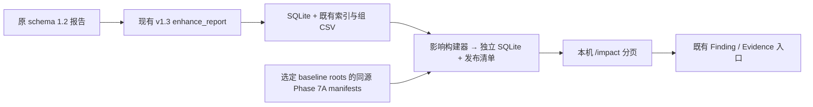

# v1.4-offline-compatibility-rc1 架构

基线为 `f72a246fbce64b6e9ee2341464cbc067b5981c37`，包括 Phase 7A。七份 Phase 7B 设计保留原样。

## 实施前阻断检查

- 旧 `groups.key` 不含逐个 root 路径。若直接将其用作确认根因，会混用装载上下文。RC 保留原组为观察导航，并为双侧重放通过的直接检查建立独立上下文组。原组的成员与新证据组可同时引用一条 Finding。
- `findings.consumer_path` 等展示列有默认值。RC 仅对带实际 linker 检查标记且匹配方向、消费者和 root 的行提供关联。历史推断不具备基线绑定信用。
- 确认分支要求 Phase 7A manifest、完全匹配的原 candidate Finding、同 root 与同约束的基线正证。通过原 resolver 对两侧重放，依然服从完整度、弱符号、不同 ABI、SONAME 顺序和 secure-execution 门控。
- 包角色使用原索引，只对明确归属的直接受影响组件计影响。Provider 与 root 角色继续可查，不传播全包结论。
- 侧车以窄键引用原库，不复制原 payload、Evidence 或所有路径。发布前检查来源与全量 Finding ID，发布使用原子文件替换。中断后通过新构建重做，RC 不续写未发布数据库。

首批实现仅评估直接检查，不展开多跳路径。不自建动态加载器模型。

## 已实现数据流

普通构建使用 v1.3 已完成索引包。顺序读入 Finding 索引、Linking 成员及导航组 CSV，并与 SQLite 覆盖索引交叉检查身份、原状态、维度和组。导航组键还会重算原 ID。只复制窄键，原压缩 Finding 与证据可按需追溯。早期真实尝试中的全库 `quick_check` 与按 ID 回表对大 payload 页产生了大量离散 I/O。最终实现用既有 v1.3 对账记录、源文件字节身份、所消费表的结构和逐项索引校验作为输入门槛，新侧车仍执行 `quick_check` 和 FK 校验。

`RECORDED` 展示历史关联及缺证原因。`REPLAYED` 可处理指定根的直接检查。两种模式均区分单项 Finding 原状态、关联强度、影响等级、当前输入状态和包角色。已确认、潜在、未评估及对照未见失败分别可以查询。

接口范围默认 UNDETERMINED。`--scope-config` 接收 `{"schema":1,"rules":[{"side":"baseline","path":"/bin/app","interface":"baseline consumers on candidate:DT_NEEDED:libfoo.so","classification":"PUBLIC","authority":"Product API manifest v3"}]}` 形式的可信配置。匹配为精确 side/path/interface。组内需全覆盖且一致。冲突回退 UNDETERMINED，范围标签不授予兼容性信用。

C++ Runtime 组对 libstdc++、libc++、libc++abi、libgcc_s、libunwind、compiler-rt/libclang_rt 的链接要求或已记录 Provider 名称作提示，链接原 Finding 和后续跨库验证建议。该规则仅识别被观察的运行库线索。

[实现](02_IMPLEMENTATION_SUMMARY.md) · [测试](03_TEST_RESULTS.md) · [完整性](04_DATA_INTEGRITY.md) · [性能](05_PERFORMANCE.md) · [限制](06_KNOWN_LIMITATIONS.md) · [验收](07_RELEASE_ACCEPTANCE.md)
